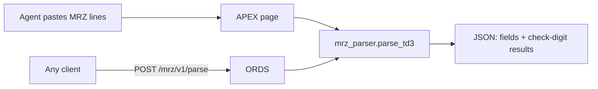

# Passport MRZ Parser for Oracle Database, ORDS and APEX

Parse and validate the machine-readable zone (MRZ) of passports inside Oracle Database: a PL/SQL package, exposed as a REST API with Oracle REST Data Services (ORDS) and demonstrated in an Oracle APEX application.

**Author:** Malik Aboud · Oracle ACE Apprentice
**Created:** 11 November 2026

> TODO before submitting: replace every TODO in this file, add the screenshots, and delete this note.

## Why

Car-rental desks, hotels and leasing companies capture passport data at the counter, often by retyping it. A single wrong character in a passport number or birth date can end up on a contract.

The MRZ carries its own error detection: ICAO check digits over every key field. This project puts that verification in the database, where the data is stored. Whatever reads the passport (a person typing, an OCR engine or an AI service), the database confirms the data is consistent before it is saved. The idea in one line: **AI reads, the database verifies.**

This repository is the verification layer. Image upload with OCR through OCI Document Understanding is the next step (see [Roadmap](#roadmap)).

## Oracle products used

- **Oracle Database / PL/SQL**: the `MRZ_PARSER` package. Tested on Oracle Autonomous Database (TODO: version); targets Oracle Database 19c and later.
- **Oracle REST Data Services (ORDS)**: `POST /mrz/v1/parse`.
- **Oracle APEX**: demo application (TODO: APEX version).

## How it works



## The MRZ in brief

A passport MRZ (format TD3) is two lines of 44 characters each. Unused positions are filled with `<`.

| Line | Positions | Field |
|---|---|---|
| 1 | 1 | Document type (`P`) |
| 1 | 2 | Document subtype or `<` |
| 1 | 3–5 | Issuing state |
| 1 | 6–44 | Name: `SURNAME<<GIVEN<NAMES` |
| 2 | 1–9 | Document number |
| 2 | 10 | Check digit |
| 2 | 11–13 | Nationality |
| 2 | 14–19 | Date of birth (YYMMDD) |
| 2 | 20 | Check digit |
| 2 | 21 | Sex (`M`, `F` or `<`) |
| 2 | 22–27 | Date of expiry (YYMMDD) |
| 2 | 28 | Check digit |
| 2 | 29–42 | Personal number (optional) |
| 2 | 43 | Check digit |
| 2 | 44 | Composite check digit over positions 1–10, 14–20 and 22–43 |

**Check digit:** multiply each character's value by the weights 7, 3, 1 (repeating), add the products and take the result modulo 10. Digits keep their value, `A`–`Z` count as 10–35 and `<` counts as 0.

Example, document number `L898902C3`:

```
L  8  9  8  9  0  2  C  3
21 8  9  8  9  0  2  12 3      values
×7 ×3 ×1 ×7 ×3 ×1 ×7 ×3 ×1     weights
147+24+9+56+27+0+14+36+3 = 316   →   316 mod 10 = 6
```

## API

```sql
mrz_parser.check_digit (p_value in varchar2) return pls_integer;
mrz_parser.parse_td3   (p_line1 in varchar2, p_line2 in varchar2) return clob;
```

`parse_td3` returns:

```json
{
  "document_type": "P",
  "issuing_country": "UTO",
  "surname": "ERIKSSON",
  "given_names": "ANNA MARIA",
  "document_number": "L898902C3",
  "nationality": "UTO",
  "birth_date": "1974-08-12",
  "sex": "F",
  "expiry_date": "2012-04-15",
  "personal_number": "ZE184226B",
  "checks": {
    "document_number": true,
    "birth_date": true,
    "expiry_date": true,
    "personal_number": true,
    "composite": true
  },
  "valid": true,
  "expired": true
}
```

Malformed input (wrong length or characters) raises `ORA-20001`. A failed check digit is not an error; it is reported in `checks`, and `valid` becomes `false`. The full rules are in the header of [`db/packages/mrz_parser.pks`](db/packages/mrz_parser.pks).

## Install

Requirements: a schema with `CREATE PROCEDURE`, REST-enabled for the ORDS part (see the comment at the top of [`db/ords/mrz_api.sql`](db/ords/mrz_api.sql)).

From the repository root, connected as the target schema in SQLcl or SQL*Plus:

```sql
@install.sql
@tests/test_mrz_parser.sql
```

On Autonomous Database, SQLcl can connect with the wallet:

```
sql -cloudconfig Wallet_<db>.zip <user>@<db>_high
```

To remove everything: `@uninstall.sql`.

## Usage

**PL/SQL**

```sql
select mrz_parser.parse_td3(
         'P<UTOERIKSSON<<ANNA<MARIA<<<<<<<<<<<<<<<<<<<',
         'L898902C36UTO7408122F1204159ZE184226B<<<<<10') as result
  from dual;
```

**REST**

```bash
curl -s -X POST "https://<ords-host>/ords/<schema-alias>/mrz/v1/parse" \
  -H "Content-Type: application/json" \
  -d '{"line1":"P<UTOERIKSSON<<ANNA<MARIA<<<<<<<<<<<<<<<<<<<","line2":"L898902C36UTO7408122F1204159ZE184226B<<<<<10"}'
```

The endpoint stores nothing. It is public for demonstration; protect it with an ORDS privilege before any real use.

## APEX demo

Build steps: [`docs/apex-demo-page.md`](docs/apex-demo-page.md). The application export is in [`apex/`](apex/), with a readable (YAML) version in [`apex/readable/`](apex/readable/).

TODO: add screenshots.


## Tests

[`tests/test_mrz_parser.sql`](tests/test_mrz_parser.sql) covers the check-digit algorithm, every field of the ICAO specimen, a tampered birth date, input clean-up and rejection of malformed lines. It ends with a summary and raises an error if any test fails.

## Data privacy

All test data is the fictional specimen published in ICAO Doc 9303. Never add real passport data to this repository. The parser and the REST endpoint store nothing.

## Roadmap

- Upload a passport image in APEX, extract the text with OCI Document Understanding, and pass the MRZ lines to `parse_td3`.
- Let the agent confirm the pre-filled form, then keep only the confirmed fields, not the image.
- Support TD1 and TD2 formats (identity cards and visas).

## AI assistance

The repository scaffolding, install scripts, ORDS module, test script and documentation were drafted with AI assistance (Claude by Anthropic) and reviewed by the author. The parsing logic in the `MRZ_PARSER` package body was written by the author.

## Credits

- International Civil Aviation Organization (ICAO), Doc 9303 *Machine Readable Travel Documents*: MRZ layout, check-digit algorithm and the specimen data used in the tests.

## License

[MIT](LICENSE) © 2026 Malik Aboud
